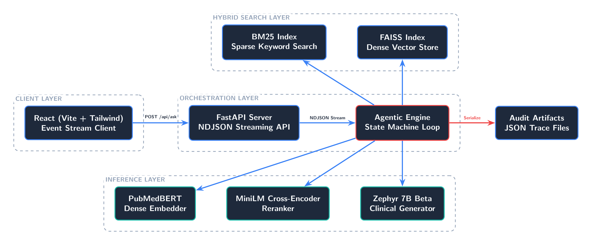
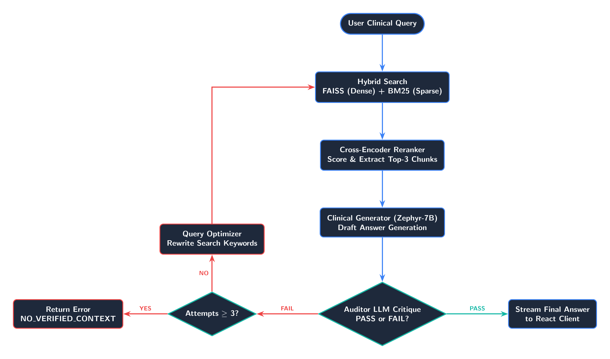

# MedSovereign-RAG

A retrieval-augmented question answering system for clinical text, built
directly on PyTorch, Hugging Face Transformers, and FAISS rather than a RAG
framework. It answers from retrieved passages and refuses to answer when it
cannot verify the result.



## What it does

- Retrieves with two methods at once: dense search over PubMedBERT embeddings in
  FAISS, and BM25 for exact drug names, medical codes, and clinical terms.
- Reranks the merged candidates with a cross-encoder, which reads query and
  passage together, so only the strongest contexts reach the generator.
- Runs the answer through a state machine where an LLM judge checks whether each
  claim is supported by the retrieved context.
- Rewrites the query and retrieves again on a failed check, up to three retries,
  then refuses instead of guessing.

## Why no framework

LangChain and LlamaIndex hide the execution graph, and with it the control over
VRAM use, retrieval order, and streaming events that this pipeline needs. The
retrieval, reranking, and self-correction loop are written directly against
PyTorch and FAISS.

## Run it

```bash
git clone https://github.com/abderrahmenex86/MedSovereign-RAG
cd MedSovereign-RAG

python -m venv venv
source venv/bin/activate
pip install -r requirements.txt

python setup_dataset.py   # download and parse the MedQuad corpus
python main.py            # start the FastAPI server
```

The frontend runs separately:

```bash
cd frontend
npm install
npm run dev
```

## How it works



A question is embedded and searched both ways, the top candidates are reranked,
and the generator drafts an answer from the surviving passages. The judge compares
the draft against those passages. A draft that fails is discarded, the question is
rewritten, and retrieval repeats. Three failures produce a refusal rather than a
partial answer.

## Limits

- Answers are grounded in MedQuad, which is a corpus of question-answer pairs
  rather than real clinical notes, so free-text records are untested.
- The judge is another language model. A confidently wrong draft that matches
  the retrieved text can still pass.
- Not a medical device and not validated for clinical use.

## Stack

Python · PyTorch · Hugging Face Transformers · FAISS · BM25 · FastAPI · React
