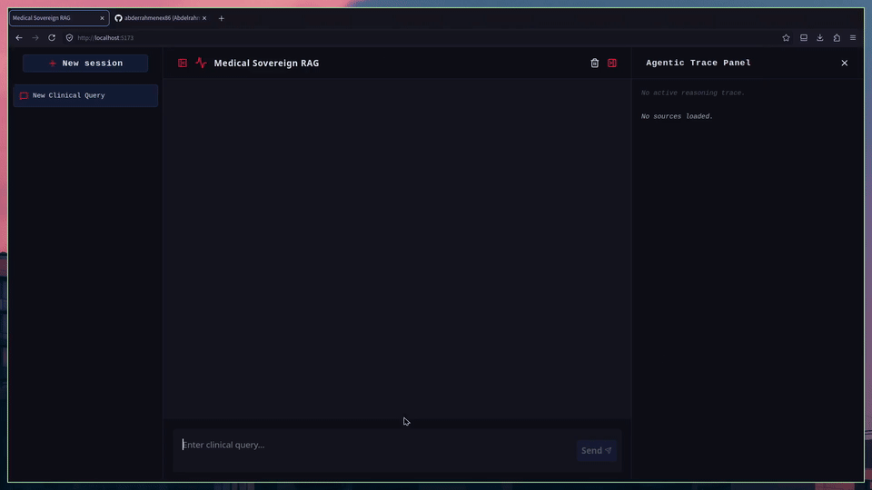

# MedSovereign-RAG


______________________________________________________________________

## Description

MedSovereign-RAG is a privacy-first Agentic Retrieval-Augmented Generation system engineered specifically for clinical environments. Built entirely from scratch without wrapper abstractions like LangChain or LlamaIndex, the platform combines hybrid dense-sparse retrieval, cross-encoder reranking, and an autonomous self-correction loop to eliminate medical hallucinations.

______________________________________________________________________

## Demo



______________________________________________________________________

## How It Works

### System Architecture


#### Architectural Rationale

- **Native Implementation over Framework Wrappers:** High-level abstractions mask execution state and introduce unnecessary dependencies. Building the system directly with PyTorch, Hugging Face Transformers, and FAISS grants absolute control over inference graphs, VRAM allocation, and streaming events.
- **Two-Stage Hybrid Search:** Dense semantic search (FAISS + PubMedBERT) captures conceptual medical relationships, while sparse lexical search (BM25) ensures precise matching for specific drug names, medical codes, and clinical terms.
- **Cross-Encoder Reranking:** Bi-encoder vector search is fast but lacks deep query-document attention. The Cross-Encoder model evaluates the top candidates jointly, ensuring that only the most relevant contexts reach the generator model's context window.

### Agentic Workflow


#### Agentic Rationale

- **Deterministic State Machine:** Single-shot RAG systems cannot verify whether a generated answer is actually supported by retrieved documents. MedSovereign-RAG implements a strict finite state machine using an LLM-as-a-Judge auditor.
- **Self-Correction Loop:** If the auditor detects unverified claims or missing context, the system rejects the draft, triggers a Query Rewriter to refine search keywords, and re-executes retrieval (up to a maximum of 3 retries).
- **Graceful Failure:** If valid clinical context cannot be verified after maximum retries, the system explicitly rejects the query rather than producing unverified medical guidance.

______________________________________________________________________

## Quickstart

### 1. Backend Setup

```bash
git clone https://github.com/your-username/MedSovereign-RAG.git
cd MedSovereign-RAG

python -m venv venv
source venv/bin/activate
pip install -r requirements.txt

# Download and parse the MedQuad corpus
python setup_dataset.py

# Launch the FastAPI production server
python main.py
```

### 2. Frontend Setup

```bash
cd frontend
npm install
npm run dev
```
