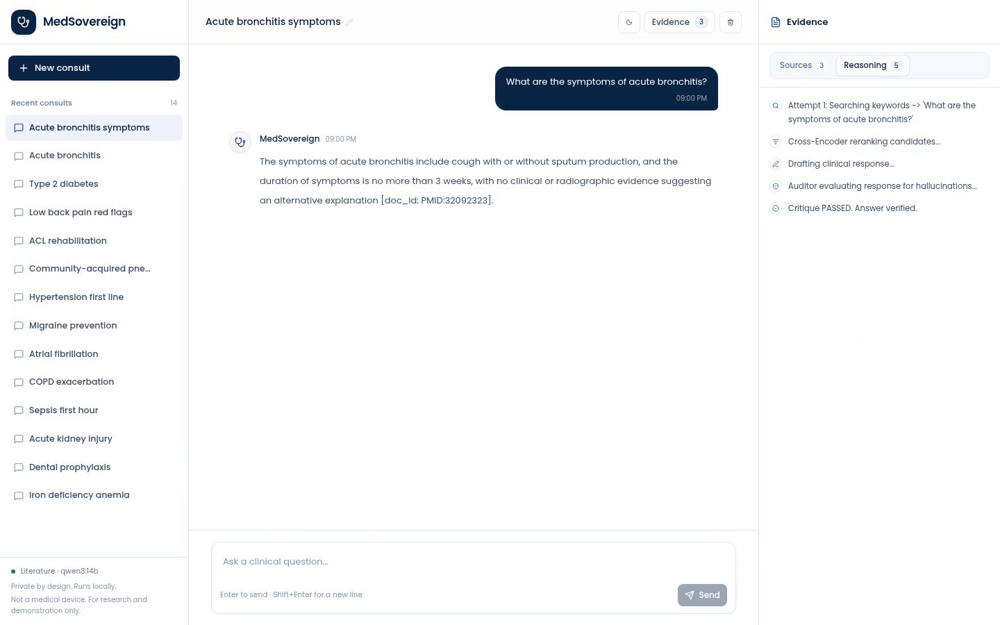
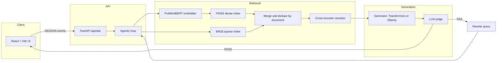

# MedSovereign-RAG

MedSovereign-RAG answers clinical questions by retrieving biomedical literature, reranking the passages, drafting an answer, and sending the draft through an LLM judge before showing it. I built it to keep the retrieval and verification loop explicit: dense and sparse search, cross-encoder reranking, a grounded draft, and a PASS/FAIL audit are separate stages you can inspect in the trace. It is aimed at ML engineers and clinical-informatics reviewers who want to see how a small RAG system behaves on real biomedical abstracts. The generator is pluggable: Zephyr-7B through Transformers by default, or a local model such as `qwen3:14b` through Ollama. If the judge cannot verify an answer within three attempts, the pipeline returns `REFUSED` and discards the draft.

https://github.com/user-attachments/assets/f4c9eb8c-78a9-457f-a41d-8f1c1cfdc127

_The 40.4-second silent demo follows the seeded acute-bronchitis conversation from question to judge PASS, then a follow-up and the dark-mode reveal._

## Contents

- [What it does](#what-it-does)
- [Why no framework](#why-no-framework)
- [What stays local](#what-stays-local)
- [Demo](#demo)
- [Evaluation](#evaluation)
- [Dataset](#dataset)
- [Requirements](#requirements)
- [Run it](#run-it)
- [How it works](#how-it-works)
- [Configuration](#configuration)
- [API](#api)
- [Frontend](#frontend)
- [Development](#development)
- [Limits](#limits)
- [Stack](#stack)

## What it does

- Runs PubMedBERT dense search in FAISS and BM25 sparse search over the same chunks, merges the candidates, and keeps one chunk per source document.
- Chunks JSONL abstracts by section, so a passage never crosses a Methods/Results boundary. MedQuad answers are chunked as a single body.
- Reranks each query-passage pair with a cross-encoder and keeps the best chunk per document. The default context is three documents.
- Sends the generator only the selected passages and asks for citations in `[doc_id]` form. The prompt tells the model to output `CONTEXT_MISSING` when the context cannot answer.
- Sends the draft through an LLM judge that checks whether it is supported by the context and whether it answers the question. A failed check rewrites the query and reruns retrieval.
- Streams newline-delimited JSON to the browser, with a cancel endpoint and a disconnect watcher that stop the generator between tokens.
- Keeps sessions in localStorage, generates a short conversation title from the first question, and separates Sources from the Reasoning trace in the Evidence panel.

## Why no framework

LangChain and LlamaIndex would hide the execution graph. I kept the loop explicit so retrieval order, prompt construction, streaming events, and the judge's decision stay visible. Every attempt is written to a trace with the rewritten query, retrieved context, draft, critique, and outcome. The engine depends on a small generator interface, so swapping Transformers for Ollama changes the backend and not the pipeline.

## What stays local

The API binds to `127.0.0.1` by default. The embedder, reranker, and Transformers generator load in that process; the Ollama backend talks to a local server on `127.0.0.1:11434`.

Queries and retrieved passages stay in memory during a request. With `PERSIST_TRACES=true`, the API writes the query, context, draft, critique, and timing to `artifacts/production_api`. Set it to `false` before sending sensitive text.

The browser stores sessions, titles, panel state, and theme in localStorage under `medsovereign-v3-storage`. Demo mode (`VITE_DEMO_MODE=true` or `?demo=1`) runs entirely in the browser with a synthetic stream.

Outbound requests happen during setup and ingestion: Hugging Face for model weights, NCBI E-utilities or Europe PMC for corpus records, and Google Fonts for Poppins. The source has no analytics or telemetry calls.

The API has no authentication. Keep the loopback bind or put an authenticated reverse proxy in front of it.

## Demo

The recording is at `docs/figs/demo.mp4`. It is silent, 40.4 seconds long, 1440x900, and has no audio track. The explanation is in the intro card, five step cards, a dark-mode feature card, and the outro card.

The video follows one seeded conversation:

1. The sidebar holds 14 seeded consultations. The active one asks, "What are the symptoms of acute bronchitis?"
2. The backend generates the title "Acute bronchitis symptoms" from the question. The title is editable in the header.
3. The answer streams with a citation to [PMID 32092323](https://pubmed.ncbi.nlm.nih.gov/32092323/). The Evidence panel lists three PubMed records; the Reasoning tab ends with "Critique PASSED. Answer verified."
4. A follow-up asks when antibiotics are indicated for acute bronchitis. The pipeline retrieves a different set of passages and returns a second verified answer.
5. The last beat toggles dark mode through the 900 ms radial reveal.



_The verified answer and Reasoning trace from the recording. The Sources tab holds the three cited PubMed records._

The demo run used the following setup:

| Item | Value |
| --- | --- |
| Corpus | 124,550 documents, 554 MB |
| Chunks | 470,655 |
| Index cache | 2.4 GB |
| GPU | RTX 3090, 24 GB |
| Generator | `qwen3:14b` through Ollama, Q4, 8192 context |
| Warm throughput | about 20 tokens per second |
| Index build | about 40 minutes on the 3090 |
| Recording | 40.4 seconds, 1440x900, no audio |

These numbers describe the recorded run, not a benchmark. The seed payload and Playwright recorder live in `artifacts/demo/` and are gitignored. The seeded conversations are illustrative UI content, not patient records.

## Evaluation

I did not commit a retrieval metrics file. The evaluation script measures the hybrid candidate stage before cross-encoder reranking, so its numbers are not a score for the full answering pipeline.

```bash
CORPUS_FORMAT=jsonl CORPUS_PATH=dataset/pubmed.jsonl \
  python scripts/evaluate_retrieval.py --limit 200 --k 10
```

The script takes the first 200 PubMedQA rows whose labeled PMID is in the corpus and retrieves the top 10 candidates for each question. It writes `artifacts/eval/pubmedqa.json` with the metrics and up to 20 failures.

| Metric | What it measures |
| --- | --- |
| `recall@1` | Share of questions whose labeled PMID is the first candidate |
| `recall@5` | Share of questions whose labeled PMID is in the first five candidates |
| `recall@10` | Share of questions whose labeled PMID is in the first ten candidates |
| `mrr@10` | Mean reciprocal rank of the labeled PMID within the first ten candidates |

`missing_targets` counts labeled PMIDs that are absent from the corpus. Fetch the corpus with `--include-pubmedqa` before trusting the run. MedQuad does not contain PubMedQA targets, so this evaluation needs the JSONL corpus.

## Dataset

Two corpora are supported.

### MedQuad

`setup_dataset.py` downloads `keivalya/MedQuad-MedicalQnADataset`, removes duplicate answers, and writes `dataset/medquad_corpus.json`. The local file has 16,407 records and is about 23 MB. MedQuad is a set of consumer question-answer pairs from NIH pages, not clinical notes.

```bash
python setup_dataset.py
```

### Europe PMC

Europe PMC exposes MEDLINE records with cursor-based paging. PubMed's ESearch stops at 9,999 records, which is why the large-corpus fetcher uses Europe PMC instead.

```bash
python scripts/fetch_europepmc.py --limit 100000 --include-pubmedqa
```

The default query selects guidelines, systematic reviews, meta-analyses, and randomized trials from 2015 to 2026 that have abstracts. `--include-pubmedqa` adds the 1,000 PubMedQA PMIDs used by the evaluation. The base fetch was about 445 MB for 101,000 records in the demo run.

For the recorded demo I also ran the topic supplement:

```bash
python scripts/fetch_demo_topics.py --per-topic 2000
```

That appended 23,550 records for acute bronchitis, type 2 diabetes, low back pain, ACL reconstruction, community-acquired pneumonia, hypertension, migraine, atrial fibrillation, COPD, sepsis, acute kidney injury, antibiotic prophylaxis, iron deficiency anemia, and gout. The final corpus was 124,550 documents and 554 MB.

`scripts/fetch_pubmed.py` remains available for small PubMed pulls. It stops at 9,999 records by design and supports `--reuse-manifest` and `--resume`.

### Chunking

JSONL abstracts are chunked by section with a 300-word window and 50-word overlap. MedQuad answers use the same window without headings. The demo corpus produced 470,655 chunks. Each abstract section was chunked independently with the same window.

### Licenses

The repository does not redistribute the corpus. PubMed abstracts remain under NLM and publisher terms, MedQuad has no declared license, and PubMedQA is for evaluation use. See `NOTICE.md` before redistributing any corpus.

## Requirements

- Python 3.11 or newer. `pyproject.toml` sets the floor.
- Node 20.19 or newer on the 20.x line, or 22.12 and newer. Vite 8 declares that range.
- A CUDA GPU with 24 GB of VRAM is recommended for the default Zephyr-7B generator. The weights are about 14 GB in bf16, before the embedder, reranker, and KV cache. A 16 GB card can run `qwen3:8b` or `medgemma:4b` through Ollama.
- About 20 GB of disk for Hugging Face weights, plus the corpus and index. The recorded 470,655-chunk index cache was 2.4 GB; the Europe PMC corpus was 554 MB.
- Linux is the tested platform. macOS and Windows are untested.
- Ollama is optional. The Transformers backend does not need it.
- The frontend loads Poppins from Google Fonts, so the first page load needs network access.

## Run it

### Quickstart with MedQuad

```bash
git clone https://github.com/abderrahmenex86/MedSovereign-RAG
cd MedSovereign-RAG

python -m venv venv
source venv/bin/activate
pip install -r requirements.txt

python setup_dataset.py
python main.py
```

The first start downloads the models and builds the index. Later starts load `artifacts/index_cache/`. The recorded demo run printed the following startup line; your startup time and chunk count will differ.

```text
[medsovereign] [11/07 - 19:39] [API] System ready in 29.37s (470655 chunks on cuda). Listening on 127.0.0.1:8000.
```

Check readiness:

```bash
curl http://127.0.0.1:8000/health
```

```json
{"status":"ok","device":"cuda","corpus_chunks":470655,"corpus_documents":124550,"generator":"qwen3:14b","generator_backend":"ollama"}
```

The API returns `503` until the models and index are ready.

### Frontend

```bash
cd frontend
npm install
npm run dev
```

```text
VITE v8.3.6  ready in 265 ms
Local:   http://127.0.0.1:5173/
```

If the API is not on `localhost:8000`, copy `frontend/.env.example` to `frontend/.env` and set `VITE_API_URL`.

### Demo mode

The interface can run without a backend:

```bash
cd frontend
VITE_DEMO_MODE=true npm run dev
```

You can also open `http://localhost:5173/?demo=1`. Demo mode uses a synthetic event stream and shows a Demo badge. It only runs when the flag or query parameter is set, so it does not mask a failing backend.

### Ollama on CPU or a smaller GPU

The embedder and reranker stay local. Only the generator moves to Ollama.

```bash
sudo systemctl enable --now ollama
ollama pull medgemma:4b

GENERATOR_BACKEND=ollama OLLAMA_MODEL=medgemma:4b python main.py
```

If you do not use systemd, run `ollama serve` in another terminal. On a CPU-only laptop (Ryzen 5 4650U, 14 GB RAM) a verified answer took about 62 seconds. Embedding the full MedQuad index (about 21k chunks with the default 300/50 chunking) took about two hours on that CPU; the cache makes later starts fast. On the same laptop, a 1,000-document subset indexes in 8 to 10 minutes:

```bash
MAX_CORPUS_DOCS=1000 GENERATOR_BACKEND=ollama OLLAMA_MODEL=medgemma:4b python main.py
```

A 16 GB card can use `qwen3:8b` (about 5 GB) or `medgemma:4b` (3.3 GB). For Qwen3, set `OLLAMA_THINK=false`; thinking tokens add latency and do not help the judge. `OLLAMA_KEEP_ALIVE=10m` keeps the model resident between requests.

### Full literature corpus

```bash
python scripts/fetch_europepmc.py --limit 100000 --include-pubmedqa
python scripts/fetch_demo_topics.py --per-topic 2000

CORPUS_FORMAT=jsonl CORPUS_PATH=dataset/pubmed.jsonl \
  python scripts/build_index.py

CORPUS_FORMAT=jsonl CORPUS_PATH=dataset/pubmed.jsonl \
  GENERATOR_BACKEND=ollama OLLAMA_MODEL=qwen3:14b OLLAMA_THINK=false \
  python main.py
```

The topic supplement is optional. Without it the base corpus is 101,000 records. The demo run produced 124,550 documents and 470,655 chunks. The index build took about 40 minutes on a 3090 and wrote a 2.4 GB cache.

`fetch_europepmc.py` supports `--resume`. `fetch_pubmed.py` also supports `--reuse-manifest` for PMID lists.

Evaluate the hybrid retriever:

```bash
CORPUS_FORMAT=jsonl CORPUS_PATH=dataset/pubmed.jsonl \
  python scripts/evaluate_retrieval.py --limit 200 --k 10
```

### GPU box

Rent a 24 GB card with at least 50 GB of disk and 16 GB of host RAM. A 3090 on vast.ai was around $0.20 to $0.35 per hour at the time of writing; a short demo costs under $1.

From your machine:

```bash
./push.sh root@HOST -p PORT
```

On the instance:

```bash
curl -fsSL https://ollama.com/install.sh | sh
nohup ollama serve > /tmp/ollama.log 2>&1 &
ollama pull qwen3:14b

python3 -m venv .venv
source .venv/bin/activate
pip install -r requirements.txt

cp deploy/vast.env.example .env
python scripts/fetch_europepmc.py --limit 100000 --include-pubmedqa
python scripts/fetch_demo_topics.py --per-topic 2000
python scripts/build_index.py
python main.py
```

Tunnel the API and run the frontend locally:

```bash
ssh -p PORT root@HOST -L 8000:127.0.0.1:8000
```

```bash
cd frontend
VITE_API_URL=http://localhost:8000 npm run dev
```

Fetch the GPU-built index and corpus when you want to run the same index on the laptop:

```bash
./fetch.sh root@HOST -p PORT --all
scp -P PORT root@HOST:/workspace/MedSovereign-RAG/dataset/pubmed.jsonl dataset/
```

The index cache key hashes the corpus contents, so a cache built on the GPU box matches the same corpus on the laptop. Use the same corpus file on both sides. `push.sh` excludes `.env`, `dataset/`, `artifacts/`, `docs/figs/`, and `frontend/`.

`MODEL_DTYPE=auto` selects bfloat16 on Ampere/Ada and float16 on T4/V100. A 12 to 16 GB card works with `qwen3:8b` or `medgemma:4b`.

## How it works

The request path is the same for the Transformers and Ollama backends.



Ingestion. `src/corpus.py` reads JSONL, and `src/data.py` handles MedQuad. Each JSONL section is chunked separately with a 300-word window and 50-word overlap. Each chunk gets an ID such as `PMID:32092323#methods-0`. The text used for retrieval prepends the title and section heading. For MedQuad, the title is the source question, so the question is indexed with the answer.

Indexing. `HybridIndex` stores L2-normalized embeddings in a FAISS inner-product index and a `BM25Okapi` index over lowercased whitespace tokens. The cache key includes `CACHE_VERSION`, a SHA-256 of the corpus file, the corpus format, chunk size, overlap, embedder name, and `MAX_CORPUS_DOCS`. The cache lives under `artifacts/index_cache/<key>`.

Retrieval. The query is embedded once. Dense search returns `top_k_retrieve` chunks; BM25 returns `top_k_retrieve` chunks. `retrieve` merges the lists and keeps the first chunk for each `doc_id`, so one article cannot fill the prompt.

Reranking. `ClinicalReranker` scores each query-passage pair with the cross-encoder. `select_context` walks the sorted list and keeps the best chunk for each document until `top_k_generate` documents are selected.

Drafting. `format_context` writes a header with `[doc_id]`, source, year, title, and section, then the chunk text. The generator streams tokens and the API forwards them as `token` events. Transformers decoding is greedy and the Ollama temperature is 0.0, so a trace can be reproduced. The title is generated before retrieval with a 3-to-6-word prompt; a title failure is logged and does not stop the answer.

Verification. The judge sees the original question, the same context, and the draft. `parse_verdict` takes the first `PASS` or `FAIL` token. A failure emits a `correction` event and rewrites the query. Three failed attempts produce `REFUSED`.

Tracing. `execute_agentic_rag` records each attempt with the query used, retrieved context, draft, critique, and outcome. It writes JSON to `TRACE_DIR` and prunes the directory to `TRACE_RETENTION` files.

Streaming. `main.py` runs the blocking pipeline in a worker thread and bridges it to an async queue. `_stream_events` enforces the semaphore and emits a `queued` status when another request is active. The frontend buffers partial NDJSON lines in `src/lib/api.js`.

### Project layout

| Path | What it contains |
| --- | --- |
| `main.py` | FastAPI app, startup lifespan, health, ask, cancel, and NDJSON streaming |
| `src/config.py` | Environment configuration and validation |
| `src/corpus.py` | JSONL ingestion and section-aware chunking |
| `src/data.py` | MedQuad parsing, chunking, `HybridIndex`, cache key, retrieval |
| `src/index.py` | Index cache loading and building |
| `src/models.py` | Embedder, reranker, Transformers generator, Ollama generator |
| `src/engine.py` | Title generation, retrieval loop, judge, rewrite, traces |
| `src/evaluation.py` | Recall@k and MRR |
| `src/pubmed.py` | NCBI E-utilities client used by the PubMed fetcher |
| `scripts/` | Europe PMC fetch, PubMed fetch, demo topics, index build, retrieval eval |
| `tests/` | Backend tests for config, corpus, retrieval, engine, streaming, Ollama, and PubMed |
| `frontend/` | React 19 and Vite 8 interface |
| `deploy/vast.env.example` | GPU box environment template |
| `docs/figs/` | Interface screenshot and demo video |
| `dataset/` | MedQuad or Europe PMC corpus. Ignored by git |
| `artifacts/` | Index cache, traces, evaluation output, and the local demo pack. Ignored by git |
| `setup_dataset.py` | MedQuad download and deduplication |
| `fetch.sh`, `push.sh` | Remote artifact and code sync helpers |
| `.env.example` | Backend configuration template |

## Configuration

Every backend setting has an environment variable. The defaults come from `src/config.py` and `.env.example`.

### Backend

| Variable | Default | What it does |
| --- | --- | --- |
| `HOST` | `127.0.0.1` | API bind address |
| `PORT` | `8000` | API port |
| `SEED` | `42` | Determinism seed |
| `MAX_QUERY_LENGTH` | `2000` | Maximum query characters accepted by the API |
| `CORS_ORIGINS` | `http://localhost:5173,http://127.0.0.1:5173` | Allowed browser origins |

### Models

| Variable | Default | What it does |
| --- | --- | --- |
| `EMBEDDER_MODEL` | `pritamdeka/S-PubMedBert-MS-MARCO` | Dense embedding model |
| `RERANKER_MODEL` | `cross-encoder/ms-marco-MiniLM-L-6-v2` | Cross-encoder reranker |
| `GENERATOR_MODEL` | `HuggingFaceH4/zephyr-7b-beta` | Transformers generator |
| `MODEL_DTYPE` | `auto` | `auto`, `bf16`, `fp16`, or `fp32` |
| `GENERATOR_BACKEND` | `transformers` | `transformers` or `ollama` |
| `OLLAMA_BASE_URL` | `http://127.0.0.1:11434` | Local Ollama server |
| `OLLAMA_MODEL` | `medgemma:4b` | Model name pulled in Ollama |
| `OLLAMA_NUM_CTX` | `8192` | Generator context window |
| `OLLAMA_THINK` | unset | Set to `false` for thinking models such as Qwen3 |
| `OLLAMA_KEEP_ALIVE` | `10m` | How long Ollama keeps the model loaded |
| `OLLAMA_REQUEST_TIMEOUT` | `600` | Read timeout in seconds |

### Corpus and index

| Variable | Default | What it does |
| --- | --- | --- |
| `CORPUS_PATH` | `dataset/medquad_corpus.json` | Corpus file |
| `CORPUS_FORMAT` | `medquad` | `medquad` or `jsonl` |
| `CHUNK_SIZE` | `300` | Words per chunk |
| `CHUNK_OVERLAP` | `50` | Overlapping words between chunks |
| `MAX_CORPUS_DOCS` | `0` | Index only the first N documents; `0` keeps all |
| `INDEX_CACHE_DIR` | `artifacts/index_cache` | Parent directory for cached indices |

`CHUNK_OVERLAP` must be smaller than `CHUNK_SIZE`. `MAX_CORPUS_DOCS` is part of the cache key, so a subset index does not collide with a full index.

### Runtime

| Variable | Default | What it does |
| --- | --- | --- |
| `MAX_CONCURRENT_REQUESTS` | `1` | Concurrent pipeline jobs. Keep at 1 on one GPU |
| `PERSIST_TRACES` | `true` | Write query and context traces to disk |
| `TRACE_DIR` | `artifacts/production_api` | Trace output directory |
| `TRACE_RETENTION` | `200` | Number of trace files kept |
| `MIN_RERANK_SCORE` | unset | Optional abstention threshold on the top reranker logit |

`MIN_RERANK_SCORE` is unset by default because the score distribution depends on the corpus and reranker. Calibrate it against your own evaluation set before enabling it. Traces contain raw queries and retrieved context; set `PERSIST_TRACES=false` for sensitive text.

### Frontend

| Variable | Default | What it does |
| --- | --- | --- |
| `VITE_API_URL` | `http://localhost:8000` | Backend base URL read at build time |
| `VITE_DEMO_MODE` | unset | Set to `true` for the browser-only demo stream |

## API

### Ask

`POST /api/ask` accepts JSON and returns `application/x-ndjson`. Each line is one event.

| Field | Default | Range | What it does |
| --- | --- | --- | --- |
| `query` | required | 2 to 2000 characters | Clinical question |
| `request_id` | `null` | up to 64 characters | Cancellation ID |
| `generate_title` | `true` | boolean | Generate a conversation title |
| `max_retries` | `3` | 1 to 5 | Total attempts, including the first |
| `top_k_retrieve` | `15` | 1 to 50 | Candidate count per retriever |
| `top_k_generate` | `3` | 1 to 10 | Documents passed to the generator |

```bash
curl -N -X POST http://127.0.0.1:8000/api/ask \
  -H 'Content-Type: application/json' \
  -d '{
    "query": "What are the symptoms of acute bronchitis?",
    "request_id": "demo-1",
    "max_retries": 3,
    "top_k_retrieve": 15,
    "top_k_generate": 3
  }'
```

### Cancel

`POST /api/cancel` sets the cancel event for an in-flight request. If the cancel arrives before the ask request registers its ID, the server remembers it and cancels the request when it arrives.

```bash
curl -X POST http://127.0.0.1:8000/api/cancel \
  -H 'Content-Type: application/json' \
  -d '{"request_id":"demo-1"}'
```

### Health

`GET /health` returns the device, corpus size, model names, and startup time. It returns `503` while the API is loading models and building or loading the index.

### Events

| Event | Meaning |
| --- | --- |
| `title` | Generated conversation title. Best effort |
| `status` | Progress. Steps are `queued`, `search`, `rerank`, `drafting`, `critique`, and `success` |
| `sources` | Selected chunks with `doc_id`, `title`, `source`, `published`, `pmid`, `url`, `section`, `text`, and scores |
| `token` | One generated token |
| `correction` | A judge failure, empty context, or threshold miss; a rewrite follows |
| `error` | Pipeline failure; a `done` event follows |
| `done` | Final trace with `status`, `attempts`, `duration_s`, `iterations`, and `final_answer` when successful |

`done.trace.status` is one of `SUCCESS`, `REFUSED`, `CANCELLED`, or `ERROR`. The API is single-turn: it does not send previous messages to the model, so follow-up questions must repeat the clinical context.

## Frontend

The UI is a React 19 single-page app built with Vite 8, Tailwind CSS 4, and Zustand 5.

- `src/lib/api.js` streams NDJSON and buffers partial lines. A JSON object can arrive split across two network reads, so parsing each chunk independently loses events.
- `src/store.js` persists sessions, titles, panel state, and theme to localStorage under `medsovereign-v3-storage`. In-flight drafts and the generating flag are deliberately excluded.
- `src/lib/demo.js` provides the browser-only demo stream for `VITE_DEMO_MODE=true` and `?demo=1`.
- The header shows an editable conversation title. A generated title is applied unless the user has renamed the session, which sets `titleLocked`.
- The Evidence panel has Sources and Reasoning tabs. Sources show the PubMed ID, year, relevance score, expandable abstract text, and an Open source link.
- Dark mode uses a 900 ms radial reveal from the toggle. The theme is applied before React mounts to avoid a flash.

## Development

```bash
pip install -r requirements-dev.txt
pytest
ruff check .
mypy .

cd frontend
npm run lint
npm run build
```

The backend suite covers configuration parsing, corpus ingestion, hybrid retrieval, engine outcomes, streaming, cancellation, the Ollama client, and the PubMed client. The frontend has ESLint and a production build check.

## Limits

MedSovereign-RAG is a research and demonstration project. It is not a medical device and has not been validated for diagnosis, treatment, or clinical decision-making. Do not use it with patient data.

The default MedQuad corpus is a set of consumer question-answer pairs, not clinical notes. Europe PMC provides abstracts, not full text. Free-text clinical notes, scanned documents, and EHR data are untested. Neither corpus is a systematic sample of the literature, and the demo topic supplement overrepresents 14 conditions. PMC full text, DailyMed, and MedlinePlus adapters are not implemented.

The judge is another language model. A wrong draft that is supported by the retrieved text can pass, and a correct draft can fail because the judge is strict or the context is thin. I did not commit a human evaluation or a PubMedQA metrics file, so the benefit of the retry loop over a single pass is unmeasured.

The evaluation script scores the hybrid retrieval stage before cross-encoder reranking. It does not measure the reranker, the generator, or the judge.

The API is single-turn. It does not send conversation history, so follow-up questions must repeat the clinical context; the seeded demo does this.

The API has no authentication and one concurrent request by default. Cancellation is best effort. Traces contain the raw query and retrieved context; disable `PERSIST_TRACES` for sensitive text.

The 24 GB recommendation comes from Zephyr-7B in bf16 plus the embedder, reranker, and KV cache. A 16 GB card needs a smaller Ollama model. CPU inference works but is slow: about 5 to 10 tokens per second for a 4B model, and a verified answer took about 62 seconds on a Ryzen 5 4650U with 14 GB RAM. Embedding the MedQuad index (about 21k chunks with the default 300/50 chunking) on that CPU took about two hours. A 7B Transformers generator on CPU is not practical for interactive use.

The demo index used 2.4 GB of cache for 470,655 chunks. Disk use grows with the corpus and with each cached index variant.

Linux is the tested platform. macOS and Windows are untested. The frontend has no native mobile app.

The embedding model is CC BY-NC 2.0, which forbids commercial use. MedQuad has no declared license. PubMed abstracts remain under NLM and publisher terms. See `NOTICE.md`.

The repository does not redistribute the corpus or model weights.

## Stack

| Layer | Choice |
| --- | --- |
| Backend | Python 3.11+, FastAPI 0.115+, Uvicorn 0.30+ |
| Retrieval | PyTorch 2.4+, Transformers 4.56+, FAISS 1.8+, rank-bm25 0.2.2+ |
| Models | PubMedBERT embedder, MiniLM cross-encoder, Zephyr-7B or an Ollama model |
| Frontend | React 19, Vite 8, Tailwind CSS 4, Zustand 5 |
| Typography | Poppins, SIL OFL 1.1 |
| Streaming | NDJSON over `fetch` with a ReadableStream reader |
| Testing | pytest, ruff, mypy, ESLint |
